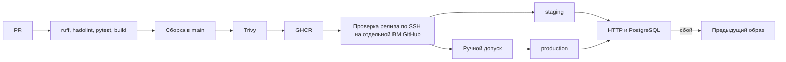

# compose-app-cicd

[](https://github.com/nikit0id/compose-app-cicd/actions/workflows/ci.yml)

Проект доставляет [portfolio-api](https://github.com/nikit0id/portfolio-api) через GitHub Actions в Docker Compose. Версия исходного кода закреплена полным SHA в файле `api-revision`. Новый релиз приложения начинается с изменения этого файла в PR.



## Запуск за три команды

Потребуются Git, Docker Compose v2, Bash и OpenSSL. Скрипт собирает закреплённую ревизию API локально.

```bash
git clone https://github.com/nikit0id/compose-app-cicd && cd compose-app-cicd
./scripts/init-env
./scripts/local-up
```

Откройте http://127.0.0.1:18080/docs или запросите /health. Порт задаёт API_PORT в deploy/.env.

## Что внутри

- PR запускает Ruff, Hadolint, ShellCheck, pytest с PostgreSQL и сборку. В main workflow сканирует образ Trivy и публикует его в GHCR при отсутствии CRITICAL. Тег соответствует SHA репозитория доставки, метка OCI revision указывает на SHA приложения. На сервер передаётся ссылка с digest.
- `deploy/release` блокирует параллельные обновления, выполняет pull и up, проверяет HTTP и записывает текущий образ. При ошибке повторно поднимает предыдущий образ. При самом первом деплое предыдущего образа ещё нет. Данные PostgreSQL остаются в томе.
- В main после публикации отдельная Ubuntu VM скачивает образ из GHCR по digest. Сценарий открывает SSH на loopback этой ВМ, выполняет тот же deploy/release и проверяет /health. ВМ удаляется после job.
- Caddy получает сертификат при включённом профиле https. /metrics доступен внутри сети Compose и через порт на loopback.
- Откат переключает образ приложения. Для будущих миграций схемы потребуется отдельная политика совместимости.

После проверки на временной ВМ job promote записывает SHA-тег и digest в portfolio-values.yaml ветки [gitops-values](https://github.com/nikit0id/compose-app-cicd/tree/gitops-values). Argo CD в [kubernetes-ops-lab](https://github.com/nikit0id/kubernetes-ops-lab) соединяет этот файл с Helm chart. Для записи в отдельный репозиторий дополнительный токен не требуется.

## Подготовка VPS и GitHub Environments

1. На каждом сервере установите Docker с Compose v2, curl, Git, Bash, OpenSSL и flock. Клонируйте репозиторий в `/opt/portfolio/staging` либо `/opt/portfolio/production`. Запустите там `scripts/init-env`. У пользователя деплоя должен быть доступ к Docker и файлам релиза. При изменении deploy/ обновите этот checkout до проверенной версии перед выпуском.
2. В deploy/.env укажите SITE_DOMAIN и COMPOSE_PROFILES=https. Направьте DNS на сервер, откройте TCP 80 и 443. Используйте отдельные VPS для staging и production. При закрытом пакете GHCR заранее выполните docker login на сервере с доступом на чтение пакета. Для проверки внешнего HTTPS передайте PUBLIC_HEALTH_URL процессу release через окружение пользователя деплоя.
3. В GitHub создайте environments staging и production. Для production включите **Required reviewers** и укажите ревьюера. В каждом окружении задайте переменные VPS_HOST и VPS_USER, секреты VPS_SSH_KEY и VPS_KNOWN_HOSTS. Отпечаток хоста сверьте через консоль VPS.
4. Для автоматической доставки в staging задайте переменную репозитория STAGING_ENABLED=true. Для production откройте Actions → CI → Run workflow, выберите main и production. GitHub запросит подтверждение у настроенного ревьюера.

## Что я узнал

- SHA в имени тега связывает релиз с кодом доставки. Digest фиксирует содержимое образа даже при повторной сборке того же коммита.
- Контейнер может запуститься с недоступной базой. Проверка /health выполняет SQL-запрос и участвует в решении об откате.
- Запись .current после успешной проверки сохраняет последнюю рабочую версию. flock защищает эту запись при одновременных деплоях.

## Что бы сделал дальше

- Добавить проверку обратной совместимости схемы при появлении миграций.
- Измерять длительность отката и сохранять результат в истории развёртываний.
